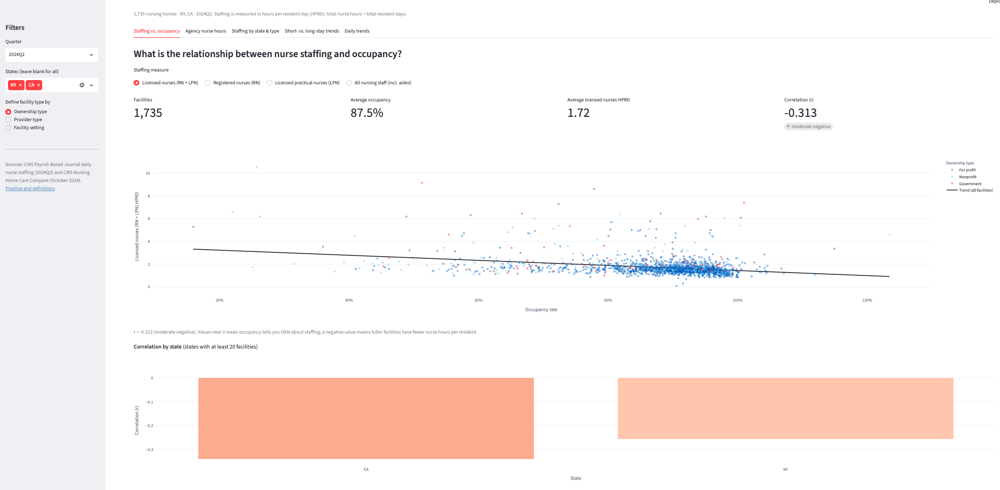
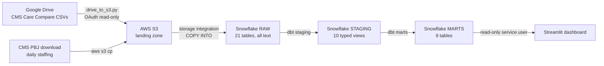

# Nursing Home Staffing & Occupancy Pipeline

An end-to-end data pipeline that moves CMS nursing home data from Google Drive through AWS S3 into Snowflake, models it with dbt, and serves it in a Streamlit dashboard.

**Live dashboard:** [nursing-home-staffing.streamlit.app](https://nursing-home-staffing.streamlit.app/)
*(Community Cloud apps sleep when idle. If you see a "wake up" button, click it and allow about 30 seconds.)*



## Questions this project answers

| Question | Answer in the data | Where |
|---|---|---|
| What is the relationship between nurse staffing levels and occupancy rates? | Almost none nationally: r = −0.08 between occupancy and licensed-nurse hours per resident day across 14,505 facilities. | Staffing vs. occupancy tab |
| Which facilities have the highest nurse overtime hours? | Overtime can't be measured from public CMS data (no per-nurse hours or headcount). The dashboard ranks facilities by **contract (agency) RN + LPN hours**, the closest public signal, with weekend staffing drop and turnover alongside. | Agency nurse hours tab |
| What are average staffing levels by state and facility type? | Averages for every state, with facility type defined three ways: ownership, provider type, and hospital-based vs. freestanding. | Staffing by state & type tab |
| What trends appear in patient length of stay over time? | Length of stay isn't in the data. The dashboard trends quality measures for **short-stay vs. long-stay** residents across four quarters, labeled as such. | Short- vs. long-stay tab |

How each metric is calculated, and why the overtime and length-of-stay answers use labeled proxies, is documented in [ADR-024](docs/decisions.md).

## Architecture



| Layer | Technology | Why |
|---|---|---|
| Landing | AWS S3 | Decouples the warehouse from a source the project can't control; versioned and replayable ([ADR-003](docs/decisions.md)) |
| Warehouse | Snowflake | Native S3 loading, role-based access, separate storage and compute ([ADR-007](docs/decisions.md)) |
| Transformation | dbt | Version-controlled SQL with tests, documentation, and lineage ([ADR-012](docs/decisions.md)) |
| Dashboard | Streamlit on Community Cloud | Code-based, deployed from this repo, viewable without a Snowflake login ([ADR-014](docs/decisions.md)) |

Every tool choice, including the ones considered and rejected, is recorded in [`docs/decisions.md`](docs/decisions.md) (24 decision records). The layer-by-layer design is in [`docs/architecture.md`](docs/architecture.md).

## Key results

- **Staffing matches CMS's national benchmark.** Average total nurse staffing is **3.84 hours per resident day**, in line with CMS's published national average, which independently validates the load and the metric definitions.
- **Occupancy averages 78.4%**, and it says almost nothing about staffing (r = −0.08).
- **Agency nurse use is highly concentrated.** The median facility gets **0.8%** of its licensed-nurse hours from contract staff, while the top facility uses about **3,300 contract hours a week**, roughly 83 full-time nurses' worth.

More in [`docs/findings.md`](docs/findings.md).

## Data quality

- **Lossless loading:** row counts for all 17 profiled source files match exactly between the source CSVs, S3, and Snowflake; all 1,325,324 PBJ rows loaded.
- **Lossless typing:** a reconciliation check confirms no values were lost when text columns were cast to numbers and dates.
- **62 dbt tests** cover unique keys, required fields, valid codes, and relationships between tables. Two expected exceptions are documented warnings rather than failures: 170 VBP facilities and 17 PBJ facilities that closed or left the program before the current provider list.
- **Profiling first:** the data was profiled in DuckDB before any warehouse design ([`docs/profiling_findings.md`](docs/profiling_findings.md)).

## Security

Each system has its own least-privilege identity, and no credential is stored in the repository.

| Identity | Can do |
|---|---|
| `cms-ingest` (AWS IAM user) | Write files to the landing path; cannot read or delete |
| `snowflake-cms-role` (AWS IAM role) | Read the landing path; assumed only by this Snowflake account (external ID) |
| `DBT_SVC` / `TRANSFORMER` | Read raw; build staging and marts (key-pair auth) |
| `STREAMLIT_SVC` / `DASHBOARD_READER` | Read marts only (key-pair auth) |

## Limitations

- **Overtime** and **length of stay** aren't in public CMS data; the dashboard uses clearly labeled proxies.
- **PBJ covers one quarter** (Q2 2024), and Care Compare is a single release (October 2024). The pipeline stores every release it loads, so trends extend automatically as new files arrive.
- Care Compare quality measure scores and PBJ staffing cover different time periods.

## Repository

```
dashboard/        Streamlit app
dbt/              staging and mart models, tests, macros
docs/             decisions, architecture, setup runbook, findings, screenshots
infrastructure/   AWS IAM policies
ingestion/        Google Drive → S3 script
profiling/        DuckDB profiling scripts and queries
snowflake/        warehouse setup, raw table DDL, loads, access roles
```

To rebuild the pipeline from scratch, follow [`docs/setup.md`](docs/setup.md).

## Data sources

- CMS Nursing Home Care Compare, October 2024 release, with FY 2024 SNF Value-Based Purchasing files
- CMS Payroll-Based Journal daily nurse staffing, Q2 2024

Both are public datasets published by the Centers for Medicare & Medicaid Services on data.cms.gov.

## Author

Peter Rousseau
