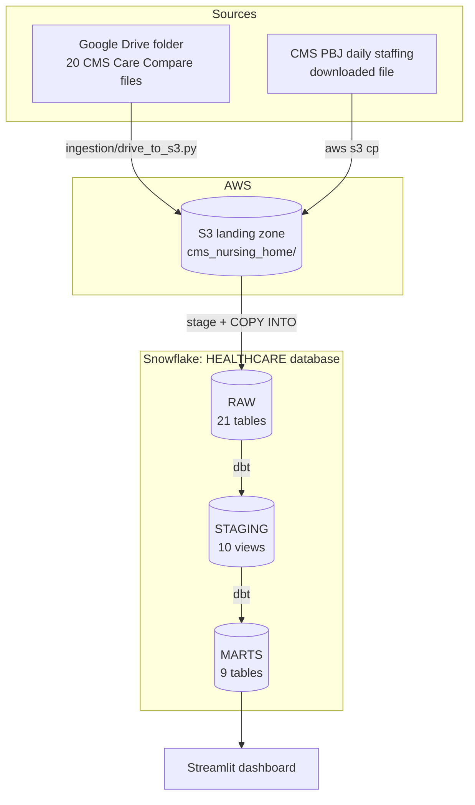

# Architecture

This document walks through the pipeline layer by layer. The reasoning behind each choice is in [`decisions.md`](decisions.md); rebuild steps are in [`setup.md`](setup.md).



## 1. Sources

- **CMS Nursing Home Care Compare (October 2024):** 20 CSV files in a shared Google Drive folder that the project can read but not modify. The provider information file is the hub; other facility files join to it on the CMS Certification Number (CCN).
- **CMS Payroll-Based Journal (Q2 2024):** daily nurse staffing hours and resident census for each facility, added to answer the staffing questions (ADR-023).

## 2. Ingestion → S3 landing zone

`ingestion/drive_to_s3.py` signs into Google Drive with read-only OAuth and copies each CSV to S3 using the write-only `cms-ingest` identity. Files keep their original names under a release folder:

```
s3://peter-cms-nursing-home-2026/cms_nursing_home/
├── release=2024-10/      Care Compare files
└── pbj/quarter=2024Q2/   PBJ files
```

The script is safe to re-run: files already present at the same size are skipped. Each object records its Drive file ID, checksum, and modified time as metadata. The bucket is private and versioned (ADR-003, 004, 017, 018).

## 3. Raw layer (Snowflake `RAW`)

A storage integration lets Snowflake read the bucket by assuming an IAM role, so no AWS keys are stored in Snowflake (ADR-006). An external stage points at the landing path.

- One table per source file, with columns generated from each file's header. Every column is text, so loads never fail on unexpected values (ADR-011, 019).
- Each row carries `_SOURCE_FILE` and `_LOADED_AT` for lineage.
- Loads are append-only. Each `COPY INTO` pattern matches its file in any release folder, and Snowflake's load history skips files already loaded, so the same scripts load future releases without duplicating rows.

## 4. Staging layer (dbt → `STAGING`)

One view per source table that the dashboard needs (ADR-021), following the same conventions (ADR-022):

- columns renamed to snake_case
- types cast with `TRY_` functions, so an unconvertible value becomes NULL instead of failing the build, with tests and a reconciliation check guarding against silent loss
- Y/N flags converted to booleans, and placeholder values (like phone `0000001111`) to NULL
- Care Compare models keep only the latest release; PBJ keeps every quarter, because it's a time series

| Model | Grain |
|---|---|
| `stg_nh_provider_info` | facility |
| `stg_nh_health_citations` | citation |
| `stg_nh_citation_descriptions` | deficiency tag |
| `stg_nh_ownership` | facility × owner |
| `stg_nh_penalties` | penalty |
| `stg_nh_quality_measures_mds` | facility × measure |
| `stg_nh_quality_measures_claims` | facility × measure |
| `stg_snf_vbp_facility_performance` | facility |
| `stg_pbj_daily_nurse_staffing` | facility × day |
| `stg_nh_data_collection_intervals` | measure |

The other 11 raw tables are loaded and documented as sources, ready to be staged when needed.

## 5. Marts layer (dbt → `MARTS`)

Tables built around the dashboard questions (ADR-024):

| Model | Grain | Purpose |
|---|---|---|
| `dim_facility` | facility | Attributes plus the three facility-type groupings |
| `dim_measure` | measure | Quality measures, short-stay or long-stay |
| `fct_daily_staffing` | facility × day | PBJ hours grouped into RN, LPN, and nurse aide; daily occupancy |
| `fct_quality_measure_quarters` | facility × measure × quarter | Quarterly MDS scores |
| `mart_facility_staffing` | facility × quarter | Staffing levels, occupancy, strain measures, agency-hours ranking |
| `mart_staffing_occupancy_correlation` | state × quarter | Question 1 |
| `mart_staffing_by_state_and_type` | state × facility type × quarter | Question 3 |
| `mart_daily_staffing_trend` | state × day | Daily trends |
| `mart_stay_type_quality_trend` | measure × quarter | Question 4 |

## 6. Serving (Streamlit)

`dashboard/app.py` reads only the marts, through the `STREAMLIT_SVC` service user and the `DASHBOARD_READER` role. Query results are cached for 24 hours, so page views don't keep the warehouse running. Credentials live in Streamlit Cloud's secrets store, never in the repository (ADR-014, 015).

## Security model

| Identity | System | Permissions | Authentication |
|---|---|---|---|
| `cms-ingest` | AWS IAM user | `PutObject` and list on the landing prefix | Access key in a local CLI profile |
| `snowflake-cms-role` | AWS IAM role | Read and list on the landing prefix | Assumed by Snowflake, external ID |
| `SYSADMIN` | Snowflake | Owns warehouse, database, schemas, raw tables | Administrator login |
| `TRANSFORMER` / `DBT_SVC` | Snowflake | Read raw; create in staging and marts | Key pair |
| `DASHBOARD_READER` / `STREAMLIT_SVC` | Snowflake | Read marts only | Key pair |

Roles and users are created by `SECURITYADMIN`; `ACCOUNTADMIN` is used only for the storage integration (ADR-005, 008, 020).

## Testing

- **dbt tests (62):** unique and not-null keys, accepted values, and relationships between models. Known gaps (closed facilities) are warnings with documented counts.
- **Reconciliation:** source row counts vs. raw, and non-null counts raw vs. staging after type casts.
- **Plausibility:** national staffing compared with CMS's published average.

## Refresh runbook

**Monthly (Care Compare):**
1. `python ingestion/drive_to_s3.py --folder-id <ID> --release YYYY-MM`
2. Run `snowflake/03_load_raw.sql`
3. `dbt build` from the `dbt` folder

**Quarterly (PBJ):** upload the new file to `pbj/quarter=YYYYQn/`, run `snowflake/05_pbj_raw.sql`, then `dbt build`.

The dashboard picks up new data within 24 hours, when its cache expires.

## Cost controls

A single XSMALL warehouse suspends after 60 seconds idle (ADR-009); batch loading instead of continuous ingestion (ADR-010); and dashboard caching keeps page views from waking the warehouse.
